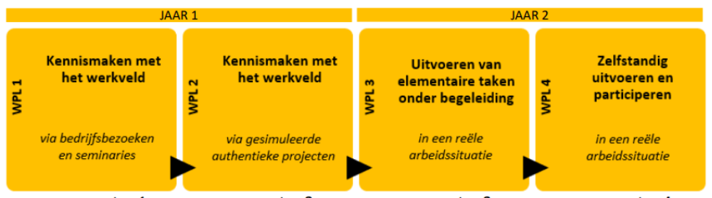

# Logboek werkplekleren
### Wat is werkplekleren?

Het logboek is jouw wekelijks dagboek van het werkplekleren. Je noteert wat er die week gebeurd is, wat je hebt geleerd, en wat je de volgende keer anders of beter wil doen.

---

## Logboek WPL 1
### Agenda 2025
| Week | Datum | Opdracht |
|------|--------|----------|
| 1 | 24 september 2025 8:30 - 11:30 | Introductie Werkplekleren 1    POP: Intro, X-factor en SDG's    Naamgevingen |
| 2 | 01 oktober 2025 8:30 - 11:30 | Taal-, LEMO- en KYSStest    Talstelsels    Testen invullen |
| 3 | 08 oktober 2025 8:30 - 11:30 | POP: motivatie, kernwaarden en reflecteren    Gastspreker Carglass    Reflectie |
| 4 | 15 oktober 2025 8:30 - 11:30 | POP: Plannen, organiseren en lerenleren    Test talstelsels    Planning |
| 5 | 22 oktober 2025 8:30 - 11:30 | Reflectie oriënteringstraject    Intro to GitHub    Uitleg portfolio    Herfstvakantie |
| 6 | 05 november 2025 8:30 - 11:30 | Gastspreker security    Opdracht aanmaken portfolio |
| 7 | 12 november 2025 8:30 - 11:30 | ChatGPT    Ethisch denken, aansprakelijkheid    Opdracht ethiek |
| 8 | 19 november 2025 8:30 - 11:30 | POP: personal branding, LinkedIn    Professionele foto    Documenteren en ticketing    Opdracht documenteren Passwordmanager |
| 9 | 26 november 2025 8:30 - 11:30 | Analyse Arbeidsmarkt    Carrièrekompas |
| 10 | 03 december 2025 8:30 - 11:30 | Opdracht actualiteit    SDG's    Klassement Passwordmanager    Advent Kalender |
| 11 | 10 december 2025 8:30 - 11:30 | Presentaties taak actualiteit |
| 12 | 17 december 2025 8:30 - 11:30 | Netwerkdag    Netwerkschema's    Kerstvakantie |
| 13 | 07 januari 2026 8:30 - 11:30 | Gastspreker Back-ups    Reflectieopdrachten portfolio |
| 14 | 14 januari 2026 8:30 - 11:30 | Uitleg Corda Campus    Afwerken portfolio    Inhaal PE's/opdrachten |

## Logboek WPL 2

?> Vul dit logboek aan zodra WPL 2 van start gaat. Gebruik dezelfde weekstructuur als hierboven.

## Logboek WPL 3

?> Vul dit logboek aan zodra WPL 3 van start gaat.

## Logboek WPL 4

?> Vul dit logboek aan zodra WPL 4 van start gaat.
