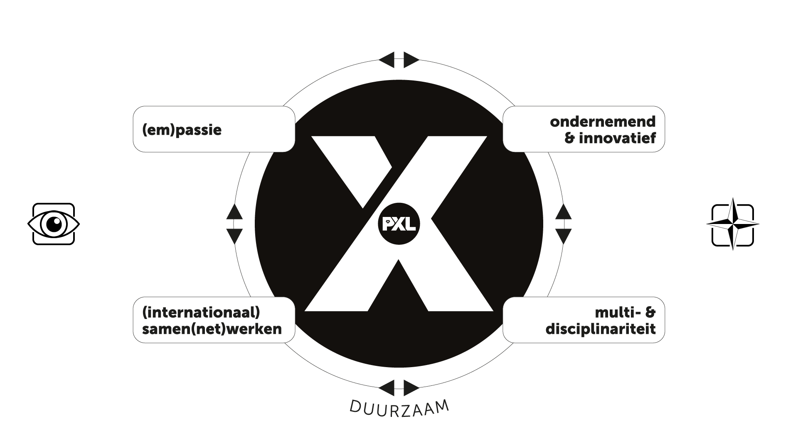

# Reflectie

Voor de reflectie gebruiken we de **AIM-methode** (Agile Insight Mentor). Die bestaat uit vier onderdelen: *Goed*, *Minder goed*, *Inzicht* en *Waardering*. Vul na elk werkplekleren alle vier de onderdelen in.

---

## Reflectie WPL 1

### 1. AIM-reflectie op voorbije periode

Start met een korte **intro** waarin je de periode van Werkplekleren beschrijft. Per onderdeel van AIM schrijf je daarna een alinea. Het resultaat is een **tekst van 5 alinea's** (min ½ A4, max 1 A4).

WPL 1 was voor mij een brede oriëntering op het werkveld van systeembeheer. We kwamen in contact met gastcolleges, technische opdrachten, zelfreflectie en persoonlijke ontwikkeling. Het was een druk maar leerrijk semester dat ik nu graag terugblik via de AIM-methode.

|   | AIM-reflectie  |
| ------- | ------- |
|  | Wat ik bijzonder positief vond aan WPL 1 was de gastspreker over cybersecurity. Die sessie heeft mij echt wakker geschud: vóór die les dacht ik dat beveiliging vooral een technische kwestie was, maar de spreker toonde aan dat menselijk gedrag de grootste zwakke schakel is. De Netwerkdag was ook een hoogtepunt — eindelijk kon ik de theorie van Packet Tracer toepassen op echt materiaal. |
|  | Wat ik minder leuk vond, was de tijdsdruk bij de actualiteitsopdracht. We kregen relatief weinig tijd om een grondig onderzoek te doen én een presentatie voor te bereiden. Ik botste ook tegenaan bij het documenteren: ik ben gewend om dingen "in mijn hoofd" te houden, maar voor een professionele handleiding is dat onvoldoende. Dat was soms frustrerend. |
|  | Mijn grootste inzicht is dat documenteren niet iets is dat je "erbij doet" — het is een kernvaardigheid van een systeembeheerder. Ik ga voortaan meteen na elke opdracht een korte samenvatting schrijven, ook als de opdracht nog niet af is. Verder heb ik geleerd dat ik bij het oplossen van problemen te snel naar de oplossing spring zonder de oorzaak te analyseren. Ik wil dit aanpakken door bewust het OSI-model te doorlopen bij netwerkstoringen. |
|  | Als persoonlijk succes beschouw ik de handleiding voor de passwordmanager. Ik was trots toen mijn klasgenoot ze zelfstandig kon volgen zonder bijkomende uitleg. Een shout-out aan Lena Martens, die mij geholpen heeft met de structuur van mijn presentatie en altijd bereid was om te reviewen. Zij verdient een shout-out voor haar collegialiteit en constructieve feedback. |

---

### 2. Wat neem ik mee naar WPL 2?

Vul minstens 1 en maximum 3 kernkwadranten in op basis van je ervaringen tijdens WPL 1.

**Kernkwaliteit**: Analytisch denken  
Valkuil: Te snel conclusies trekken  
Uitdaging: Methodisch blijven werken, ook onder tijdsdruk  
Allergie: Mensen die problemen niet systematisch aanpakken

**Kernkwaliteit**: Behulpzaamheid  
Valkuil: Te veel werk van anderen overnemen  
Uitdaging: Collega's begeleiden zonder het voor hen te doen  
Allergie: Groepswerk waar één persoon alles doet

* Mijn **talenten**: analytisch denken en technische problemen uitleggen in begrijpelijke taal. Ik heb dit kunnen toepassen bij de actualiteitsopdracht en de handleiding voor de passwordmanager.
* Mijn **valkuilen**: Ik spring soms te snel naar conclusies en documenteer niet meteen. Dit heeft me tijd gekost bij de passwordmanager-opdracht.
* Mijn **uitdagingen** voor WPL 2: bewust het OSI-model toepassen bij probleemoplossing, en na elke opdracht onmiddellijk documenteren.
* Wat ik nog wil bijleren: Windows Server met Active Directory en mijn eerste stappen zetten in Azure.

---

### 3. Reflectie over X-factor

Hieronder koppel ik mijn activiteiten van WPL 1 aan de verschillende onderdelen van de X-factor:

- **Kennis & Vaardigheden:** De Netwerkdag en de opdrachten in Packet Tracer hebben mijn technische basiskennis versterkt. Ik heb ook zelfstandig een Azure-fundamentals-cursus gevolgd.
- **Communicatie:** De presentatie over de ransomware-aanval en de handleiding voor de passwordmanager zijn concrete voorbeelden van schriftelijke en mondelinge communicatie in een technische context.
- **Samenwerking:** Tijdens groepswerk bij de actualiteitsopdracht heb ik de taakverdeling mee gecoördineerd. Ik leerde dat duidelijke afspraken vooraf veel discussie nadien vermijden.
- **Zelfontwikkeling:** De reflectieopdrachten en het kernkwadrant hebben me bewuster gemaakt van mijn eigen leerstijl en valkuilen.

Meer uitleg nodig over de X-factor en de verschillende onderdelen? Bekijk het <a href="https://rise.articulate.com/share/NI8PLFfhbaP5NfRDk5Xixybq6GG_ZyI5" target="_blank"> online leerpad</a>.

---

## Reflectie WPL 2

### 😊 Goed
[Wat vond je positief? Wat ging er goed? Wat heeft je positief verrast?]

### 😟 Minder goed
[Wat vond je frustrerend? Waar botste je tegenaan? Wat liep er mis?]

### 💡 Inzicht
[Welke nieuwe inzichten neem je mee? Wat doe je volgende keer anders? Wat bekijk je nu op een andere manier?]

### 👑 Waardering
[Wat is jouw persoonlijk succes van dit WPL? Waarop ben je trots? Wie verdient een shout-out?]

---

## Reflectie WPL 3

### 😊 Goed
[Wat vond je positief? Wat ging er goed? Wat heeft je positief verrast?]

### 😟 Minder goed
[Wat vond je frustrerend? Waar botste je tegenaan? Wat liep er mis?]

### 💡 Inzicht
[Welke nieuwe inzichten neem je mee? Wat doe je volgende keer anders? Wat bekijk je nu op een andere manier?]

### 👑 Waardering
[Wat is jouw persoonlijk succes van dit WPL? Waarop ben je trots? Wie verdient een shout-out?]

---

## Reflectie WPL 4

### 😊 Goed
[Wat vond je positief? Wat ging er goed? Wat heeft je positief verrast?]

### 😟 Minder goed
[Wat vond je frustrerend? Waar botste je tegenaan? Wat liep er mis?]

### 💡 Inzicht
[Welke nieuwe inzichten neem je mee? Wat doe je volgende keer anders? Wat bekijk je nu op een andere manier?]

### 👑 Waardering
[Wat is jouw persoonlijk succes van dit WPL? Waarop ben je trots? Wie verdient een shout-out en waarom?]

---

[**← Terug naar voorbeeldportfolio overzicht**](/Wiki/Home)
